# Tree: the granny-square Christmas tree on the lamp post

A plan for yarn bombing the lamp post on the Edithvale foreshore as a
Christmas tree: five cone skirts of crocheted granny squares, and a
crocheted star on top. This file has the granny square sizes and how they
stitch together, the flat pattern for every skirt, the star and the mesh
sleeve it stands on, the plan for mounting the whole thing on the post, and
plan B if the squares run short.

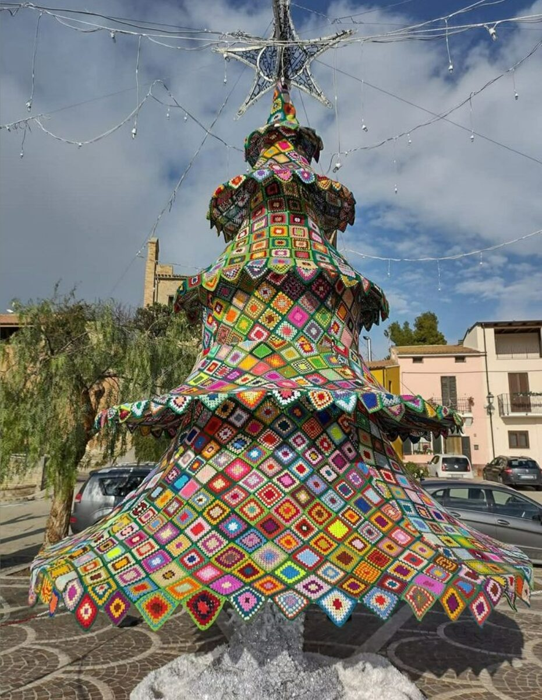

The inspiration photo, somewhere in Italy. Tiered skirts of granny squares
over a pole, with a zigzag hem on each tier.

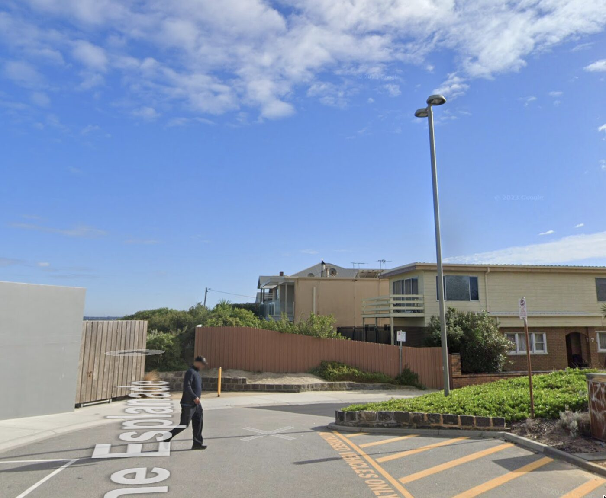

The post it goes on: steel, 14.5 cm across, with shrubs around the base that
keep the bottom hem off the ground.

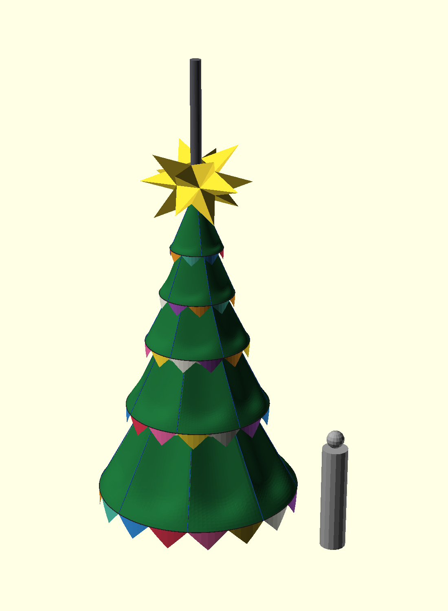

The model, with a 1.7 m person beside it for scale. Open
[platonic/tree.stl](tree.stl) to turn it around in the browser;
GitHub renders it as an interactive 3D view.

## The design

Lamp post: steel, 14.5 cm across (45 cm circumference, from an old note and
the street view), at least 7 m tall. A 6.5 m post is drawn.

Five cone skirts of granny squares, every skirt's fabric running to the
mesh sleeve on the post, no inner hoops. Hem rings of fibreglass tent pole
and hula hoop, see below. Bottom hem 54 cm off the ground because of the
shrubs round the post.

| skirt | strap on post | hem ring | hem height | hem square | squares |
| ----- | ------------- | -------- | ---------- | ---------- | ------- |
| 1     | 4.66 m        | 70 cm    | 4.01 m     | 18 cm      | 56      |
| 2     | 4.39 m        | 100 cm   | 3.38 m     | 22 cm      | 105     |
| 3     | 3.95 m        | 140 cm   | 2.70 m     | 25 cm      | 147     |
| 4     | 3.58 m        | 195 cm   | 1.77 m     | 30 cm      | 217     |
| 5     | 2.91 m        | 275 cm   | 0.54 m     | 36 cm      | 304     |

Lowered on 2026-09-15 so the star's core sits fully on the mesh sleeve: skirt
5 down 6 cm, each skirt above 7 cm more than the one below, 34 cm at the top.
Every skirt kept its drop, so the patterns and cords did not change. On
2026-09-16 skirt 1's strap went up another 5 cm, to 4.66 m, so its peak
reaches the star. That one skirt is now 65 cm tall instead of 60 cm; its
pattern changed, the other four did not.

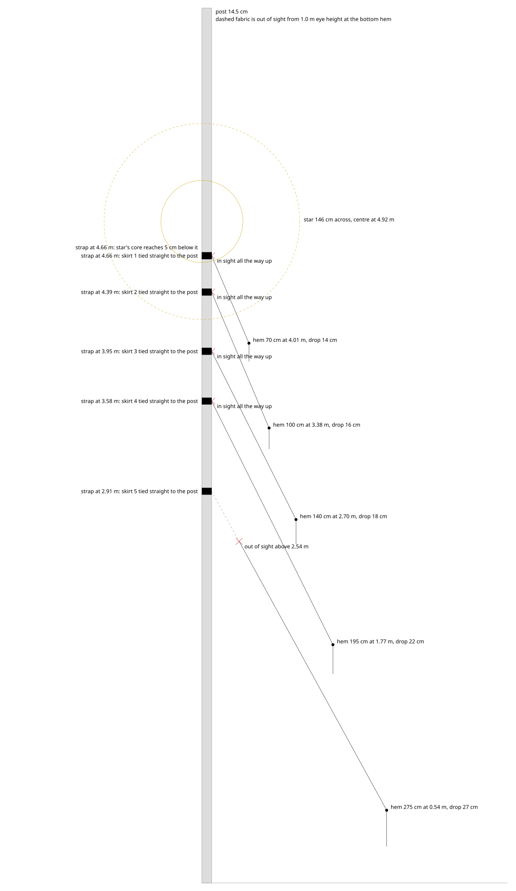

Total 829 squares. Every row of a skirt holds the same number of squares,
set on point, each row inward a little smaller (the grid is two families of
equiangular spirals, so the cells stay true squares). When a row's squares
would fall under 8 cm, four merge into one and the count halves. Hem counts
are even (8, 10, 12, 14, 16) so the merges work. The hem row is centred on
the hem ring and its lower halves hang below it as the zigzag.

### Granny squares

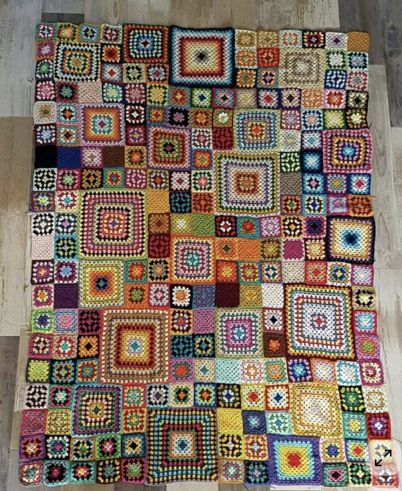

Squares are set on point, so the grid runs diagonally and the hem finishes as a
zigzag. Each row inward is a little smaller than the one below, and when a row
would fall under 8 cm the script merges four squares into one at twice the
size and halves the count. The blanket above is the look worth borrowing: not
every square the same size, but a scatter of big ones among the small, each
big one standing in for four. The merge is already how the pattern works at
the top of every skirt. Doing it lower down as well, by choice rather than by
need, would give the same uneven patchwork.

Proportions: each skirt is 0.71 as wide as the one below. The heights ran
0.8 as well until skirt 1 was raised to meet the star, and now go 0.64,
0.81, 0.69, 0.76 from the top down.

### Cords

Low-stretch cords carry the hem ring's weight to the strap, so the hem hangs
at cord length and the fabric only hangs off the cords. Each cord runs
straight up the slant from the hem ring to the strap, one cord per two hem
squares. Hem counts are even, so the cords come out evenly spaced round the
ring. Each starts at a notch of the zigzag hem, the high point between two
hanging triangles, and on the way up passes through the corner between two
squares on every second row and up the middle of the square on the rows
between. The patterns draw them in blue, numbered at the hem. `CORD_EVERY` and `CORD_TAIL` in
`skirts.py` set the spacing and the knot allowance.

| skirt | cords | each, ring to strap | to buy |
| ----- | ----- | ------------------- | ------ |
| 1     | 4     | 71 cm               | 5.2 m  |
| 2     | 5     | 110 cm              | 8.5 m  |
| 3     | 6     | 140 cm              | 12.0 m |
| 4     | 7     | 202 cm              | 18.4 m |
| 5     | 8     | 270 cm              | 26.4 m |

About 70 m of 3 mm polyester braid with 30 cm tails at both ends. Nylon
stretches and wire kinks and chafes the yarn, so neither.

Between two cords the fabric hangs in a curve. The fabric is
sewn to the hem ring, to the strap and to every cord, so the droop is nothing
on all three. Between them each panel falls through its sag point: midway
between two cords, a quarter of the way up, having fallen 45 percent of the
way from the cone down to the hem ring's own plane. The fabric therefore
never hangs below its ring. Over a cord it folds rather than rounding off, so
each cord reads as a crease the full height of the skirt.

`SAG_T`, `SAG_DROP` and `FIN` in `skirts.py` are the three numbers: where the
sag point sits, how far it falls, and how sharply the fabric folds over a
cord. The patterns are cut for the plain cone.

### Hem rings

The rings hold the hem out to its circle. They carry little load, because the
flat pattern is cut so the fabric's hem already matches the ring and the cords
take the weight. What they have to do is stay round and go on around the post.

No ring can be lifted over the lamp post. There is a lamp arm at the top and
the mesh sleeve stands on the ground, so nothing threads on from either end.
Every ring has to be closed in place, around the post, by one person standing
on the ground.

That is easier than it sounds, because the ring is not a hoop you lift. The
rod feeds through loops along the hem while the skirt already stands around the
post, and only becomes a ring when the two ends meet. Nothing is sprung open or
forced shut.

#### What goes in each ring

| skirt | diameter | radius   | circumference | ring                     | segments | fit         |
| ----- | -------- | -------- | ------------- | ------------------------ | -------- | ----------- |
| 1     | 70 cm    | 35 cm    | 2.20 m        | hula hoop, already owned |          | exact       |
| 2     | 100 cm   | 50 cm    | 3.14 m        | hula hoop, already owned |          | exact       |
| 3     | 140 cm   | 70 cm    | 4.40 m        | fibreglass tent pole     | 8        | 4 cm short  |
| 4     | 195 cm   | 97.5 cm  | 6.13 m        | fibreglass tent pole     | 11       | 14 cm short |
| 5     | 275 cm   | 137.5 cm | 8.64 m        | fibreglass tent pole     | 16       | 6 cm over   |

A segment is 57.7 cm long and adds 54.4 cm to a chain, because each one sits
3.3 cm inside its neighbour's ferrule. No ring comes out exact at 54.4 cm a
step. It does not matter. The crochet sets the circle and the rod only fills
it, and a few centimetres either way disappears into the stitches. Skirt 4's
ring is the 14 cm short one, and it is at 1.77 m, the hem most within reach,
so a twelfth segment there is an option, at the cost of putting that ring
40 cm over.

| item                                                  | quantity | cost     |
| ----------------------------------------------------- | -------- | -------- |
| Fibreglass pole kit, two 4.9 m poles of nine segments | 2 packs  | $66      |
| Fibreglass pole kit, spare                            | 1 pack   | $33      |
| 50 mm polyester webbing for the hem sleeves           | 21 m     | to price |
| 3 mm shock cord                                       | 25 m     | $35      |

About $134 for the poles and the cord, and 2.6 kg for all five rings. The
webbing went from 38 mm to 50 mm and is not priced yet. One pack of poles is
not enough on its own: two poles is 9.8 m against the 19.2 m the three big
rings need.

Two packs cover it with one segment spare out of thirty-six, which is thin
enough that one damaged in transit leaves a ring that will not close. The third
pack is cheap insurance and a spare pole is useful anyway.

No separate ferrules are needed. Every tent pole segment carries one bonded to
one end, with a bare end at the other, so a chain of them finishes with a socket
at one extreme and a spigot at the other and the ring closes on itself whatever
the count.

#### Why those materials

Poly pipe was the first plan and it will not do. It rests as a coil about a
metre across and fights you at any other diameter, so it pulls the ring into a
lobed shape wherever the crochet lets it.

**Fibreglass on the three big rings, because it springs back.** Skirt 5's hem
sits at 54 cm and skirt 4's at 1.77 m, both within reach on a public foreshore.
A child hanging on the bottom hem puts more bending into a rod than soft
aluminium tube can take elastically, and aluminium keeps every dent. Fibreglass
returns to shape, and its fatigue life takes a season of coastal wind without
complaint. It has no coil memory either: bent into a closed loop it carries the
same curvature all the way round, and a true circle is the shape it settles
into.

The tent poles are hollow, about 11 mm outside on an 8 mm bore. Hollow is where
the material earns its keep in bending: that tube is about two and a half times
stiffer than a solid 8 mm rod and lighter per metre. It is stiff enough that
skirt 5 needs one ring rather than two stacked rods.

**Hula hoops on the two small rings**, 70 cm and 100 cm, which Julia already
owns and which happen to be exactly the two diameters wanted. They come
factory-round, so nothing is bent and nothing fights its own memory, and the
connectable ones part at a push-button joint, which is the openable closure the
post demands. Free, and no bending job.

They are the right place to spend the least. Skirts 1 and 2 sit at 4.01 m and
3.38 m where no hand reaches, and they are the least flexed of the five: four
cords on a 2.2 m ring gives 55 cm spans against skirt 5's 108 cm, and bending
moment goes with span squared. Hoop tubing is roughly a fifth as stiff as the
10 mm aluminium tube that was the alternative, which does not matter on a
ring already the shape it wants to be and holding almost nothing.

Ready-made craft and lampshade hoops were the other candidate and fail the
constraint the hula hoops meet: they come welded shut, so each would have to be
cut and sleeved.

Three things to check on arrival.

- **How many poles a pack holds.** The listing contradicts itself on whether
  4.9 m is the pack or the pole. The stated weight of about 810 g only works for
  two poles, but confirm it, because one pack would then be half what is needed.
- **Whether the segments carry a shock cord.** The listing says foldable and
  lists only the poles, where other sellers of the same pole spell the cord out.
  A ring does not need it, since the loops hold the segments in line, but it
  makes threading easier and the repair kit supplies it if not.
- **The outside diameter, with calipers, before cutting or threading anything.**
  The listing gives 8 mm as the bore and the stated weight agrees, which puts
  the outside at about 11 mm. If 8 mm turns out to be the outside instead, the
  rod is two and a half times less stiff, skirt 5 wants two stacked in its
  sleeve, and that is two more packs.

The end segments also carry moulded ground spikes. Harmless, but put them at a
join or leave them in the spares.

#### Holding the ring to the hem

The hem row sits on point, so there is no plain edge to fold into a casing. The
ring line runs through the side corners where squares meet, with the lower
halves hanging below as the zigzag.

**Skirts 3, 4 and 5 get a sewn sleeve.** A crocheted loop puts a pull into one
square junction. A sleeve spreads it along the whole ring and stops the rod
chafing the yarn. Skirts 4 and 5 are the two hems within reach, and skirt 3
takes one too for the extra support.

Use 50 mm polyester webbing, the seatbelt kind, folded lengthwise and
machine-sewn into a tube. It does not rot or hold water, which rules out canvas,
denim and cotton tape over a wet month. It is the strongest thing per gram that
will go under a domestic machine, and it does not fray.

Fifty is the width. 38 mm was the first answer and it was wrong. A folded
tube passes a rod of twice its flat width over pi, not a rod as fat as the
flat width itself. Folded 38 mm gives about 17 mm flat, which is a 10.8 mm
bore, under the 11 mm rod and well under the ferrules bulging past it.
Folded 50 mm gives about 23 mm flat, a 14.6 mm bore, which clears both.
Avoid ripstop nylon, which tears along a stitch line exactly where a child
pulls. About 21 m covers the three rings with overlaps.

A straight tube is right, with no shaping and no curved cutting. Bending a
23 mm tube into a ring means the outside travels further than the inside by
the tube diameter over the ring radius, which is 3.3 percent on skirt 3, 2.4
on skirt 4 and 1.7 on skirt 5. Webbing has more give than that in its weave.
It would only start to ruck below about a 40 cm radius. The one mistake to
avoid is laying the webbing flat in the plane of the ring, width pointing
outward, which would need a curved strip. The width wraps around the rod,
and the length runs around the ring.

Order of work. Sew the long seam into an open-ended tube, stitch that to the
crochet hem, then feed the rod through and close the rod ring last. Sewing the
webbing into a closed loop first means wrestling metres of jointed rod through a
blind tube with every ferrule catching. Leave a 10 cm gap in the webbing where
the rod's join lands so you can reach it; the crochet spans it and nobody sees.

Take the length from the crochet, not from the arithmetic: finish the hem row,
lay it flat, measure it, and cut the webbing a centimetre or two shorter so the
webbing carries the load rather than the stitches. Mark the webbing every 50 cm
before sewing, because polyester creeps under machine feed tension. Pin at
quarters, then eighths, then sew between, so any discrepancy spreads evenly
instead of arriving as a bunched-up remainder. Sew it in manageable lengths and
join rather than feeding 8.6 m through in one pass.

To check a finished ring, lay it flat and measure across it at four angles. A
circle reads the same every time; more than a couple of centimetres out means
the rod is caught on something, usually a ferrule against a seam.

**Skirts 1 and 2 keep crocheted loops.** They are hula hoops, already rigid and
already their own circle, and they sit at 4.01 m and 3.38 m where no hand
reaches. Crochet a short chain loop at each square junction and thread the hoop
through. Make them wider than you would for a pole, because hoop tubing is
around 19 mm against the pole's 11 mm, so measure the hoops first. Loops can be
added to finished squares, so none of this has to be settled before the crochet
starts.

#### Keeping the segments together

Tent pole segments push into their ferrules and can pull back out, which is what
a child hanging on a hem would do. Shock cord is what stops that, and it is what
the cord does in a tent: thread one length through all the segments of a ring,
pull it tight and tie it into a loop, and every joint is held home for good.

About 20 m of 3 mm cord covers the three pole rings, around $1.40 a metre
from Bunnings or Clark Rubber, or marine grade from a specialist. Buy 25 m. Three
millimetre is the size: it passes the 8 mm bore easily, thinner will not hold
the joints home and thicker fights the ferrules. If the poles arrive already
corded there is 19.6 m in the packs and the job is re-threading it into three
ring-length loops instead of buying any.

Tape the joints as well if you want the belt with the braces. Self-amalgamating
silicone tape is the one to use: it fuses to itself with no adhesive, so nothing
goes gooey in the heat, nothing leaves residue in the yarn, and it unwraps
cleanly in January. Gaffer tape second. Duct tape holds mechanically because you
are wrapping rather than sticking, and it lives inside the sleeve out of the
sun, but its adhesive will still go soft. Sixteen joints on skirt 5 and
thirty-five across the three rings make taping tedious, which is the
argument for doing the cord first.

#### Joining

Nothing needs bending and nothing needs a separate connector. The hoops are
already their circle and close on their own push-button joint. The fibreglass
arcs as you thread it and closes on the ferrule the last segment already
carries.

Put both joins at a cord point, where the crochet is anchored. Gaffer tape over
the fibreglass one. Never a screw into fibreglass: it splits along the fibres,
and that is the one way these rods fail.

### The flat patterns

One per skirt, cut as a ring sector. The dotted arc is the hem ring, the inner
arc is the post, the blue lines are the cords and the legend carries every
measurement.

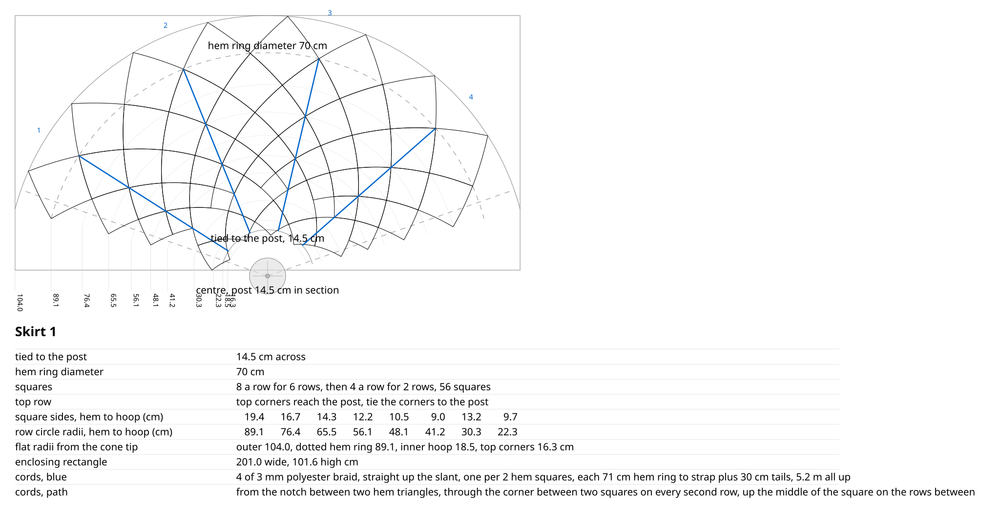

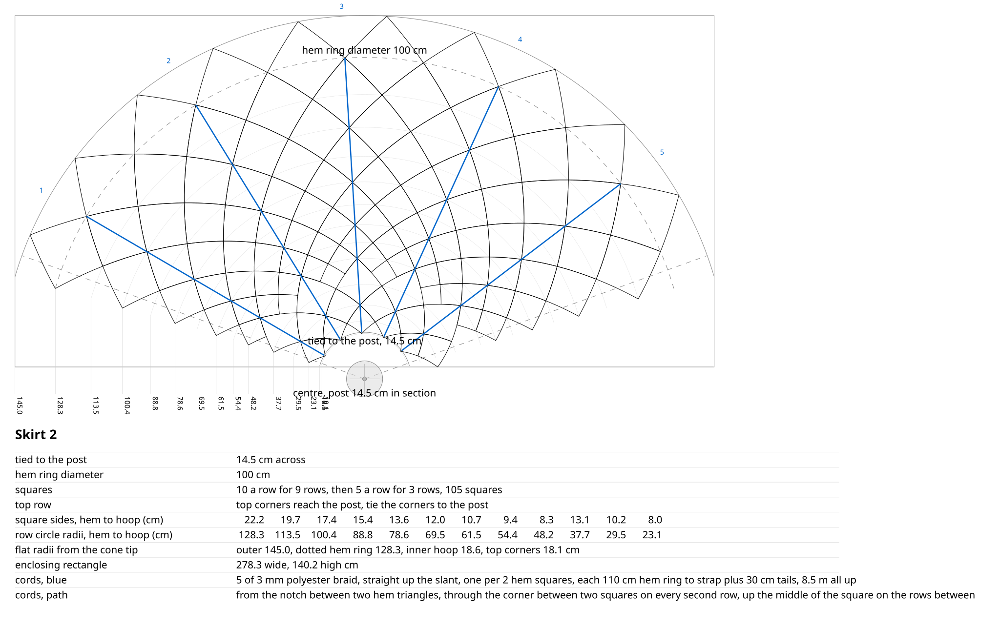

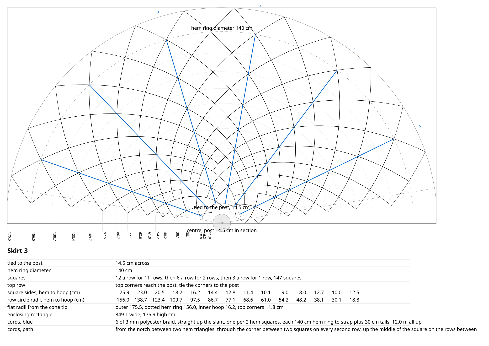

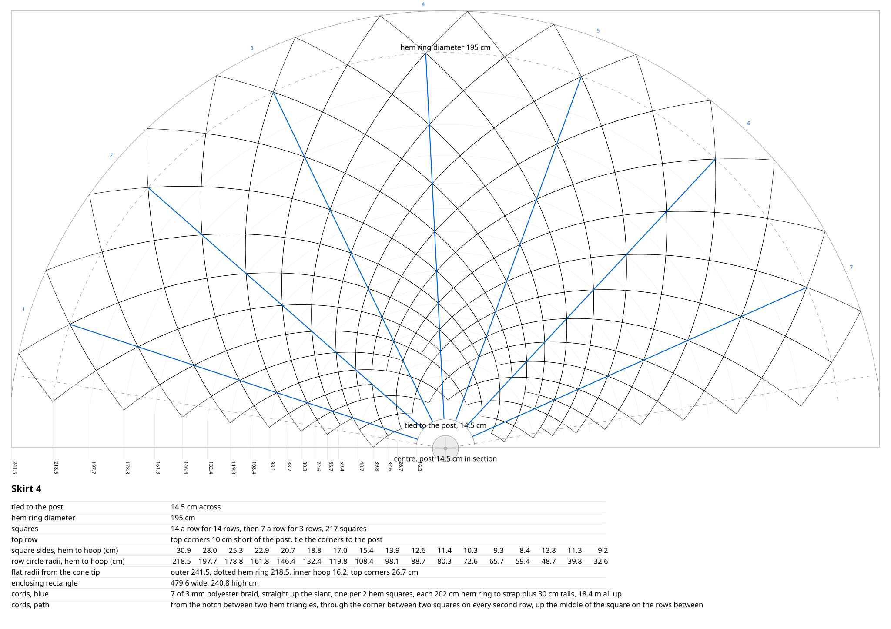

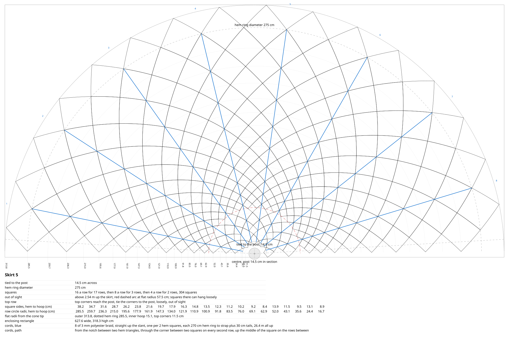

### Star

A great stellated dodecahedron, 145.5 cm across, edge up with the post through
it. The two spikes straight up, the two straight down, and the two core struts
that would cross the post are left off. The core runs from 4.61 to 5.22 m,
centred at 4.92 m. It reaches 5 cm below the top strap, so skirt 1's peak
stands inside the star and no bare post shows between them. That is
`STAR_LIFT` in `skirts.py`, now minus 50 mm.

The frame is 5 mm dowel in printed hubs and tips, which have a 5.1 mm bore.
`platonic/kepler.scad` is the model and prints the core length for any ridge
length. The crochet ties to the frame through the yarn holes in the hubs and
tips, so the star is covered rather than bare.

|              | cut    | full star | tree's star |
| ------------ | ------ | --------- | ----------- |
| ridge stakes | 490 mm | 60        | 48          |
| core stakes  | 300 mm | 30        | 28          |
| printed tips |        | 20        | 16          |
| printed hubs |        | 12        | 12          |

The cut lengths are not themselves in the golden ratio. The ratio holds centre
to centre, and a stake stops 18.8 mm short of a tip's centre but only 10.6 mm
short of a hub's centre. A ridge has one of each and a core edge has two hubs,
so the ridge measures 519.4 mm centre to centre and the core 321.0 mm, which is
1.618. The cut pieces come out at 1.63.

Julia has 5 mm dowel precut at 500 mm and 300 mm. The frame takes 48 of the
500 mm and 28 of the 300 mm. The 300 mm are core stakes untouched, and the
500 mm want 10 mm off each. That is all the cutting.

Leaving spikes and struts off leaves sixteen unused arms on the hubs,
twelve where the spikes are missing and four where the core struts are. Leave
them empty. They are 25 mm stubs on a 145 cm star, the hub's strength is in the
arms that are used, and printing reduced variants would turn one part into
four or five at nearly three hours each.

Mesh sleeve: 50 x 25 mm galvanised welded mesh, 2 mm wire, a 60 cm wide strip
wrapped on the post, two cut lengths of 2.70 and 2.65 m lapped a cell, to
5.30 m, standing on the ground. The strip laps 5 cm at the seam, so the wrapped
circumference is 55 cm and the sleeve is 17.5 cm across on the 14.5 cm post.
That leaves 15 mm all round. Skirts and star cable-tie to the mesh. The
sleeve stands on a paver or an offcut of board, not straight on the soil,
because fifty kilograms on twelve 2 mm wire ends sinks into sand.

Four hose clamps hold the sleeve to the post, at 0.2, 1.4, 2.7 and 5.2 m:
Kinetic 159-181 mm, 304 stainless, $6.75 each at Bunnings, so about $27. That
range takes the 17.5 cm sleeve with 16 mm of adjustment still in hand, which
is what pulls the sleeve tight as the noodle battens compress. The clamp at
5.2 m goes on before the sleeve is drawn up to its full height, because
nothing reaches it afterwards.

Cushioning: pool noodles cut lengthwise into battens about 20 mm square, six
of them up the post, one every 7.6 cm round the post's own circumference.
Slit a noodle once and unroll it flat, then cut the battens off the slab.
That yields far more length than splitting it into halves. Each batten
compresses from 20 mm into the 15 mm gap, so the sleeve grips rather than
rattles and the mesh never touches the paint.

Cutting: the roll is already 60 cm wide, so the two pieces come off its
length and nothing is slit. Both long edges stay as they come, which is why
the vertical seam only needs its 5 cm lap. Cut beside a wire, not through
one, snipping the crossing wires right next to the wire on the cut line.
That wire stays whole on one piece and the other piece gets a bare edge,
which is what the storey lap wants: bare edge under, wired edge over.

Tying: galvanised tie wire, 1.2 to 1.6 mm, twisted with pliers. The
horizontal join between the two storeys takes the whole weight, about 50 kg
wet, so tie it at every cell across the lap. Twelve cells go round the
sleeve, so that is about 4 kg a tie, against the 30-odd kg that breaks a
1.2 mm strand. The vertical seam only stops the sleeve springing open and the
clamps already do most of that, so every third cell is enough there. Cable
ties would hold the load but creep under steady tension and perish in UV.

The star's core, 4.61 to 5.22 m, sits fully on the sleeve with 8 cm to
spare, so its lower and upper hubs both cable-tie to the mesh. The top clamp
at 5.2 m sits 2 cm under the core's top, and the hubs tie above and below
it. Before the skirts were lowered the core ran to 5.59 m and a third mesh
storey would have been needed.

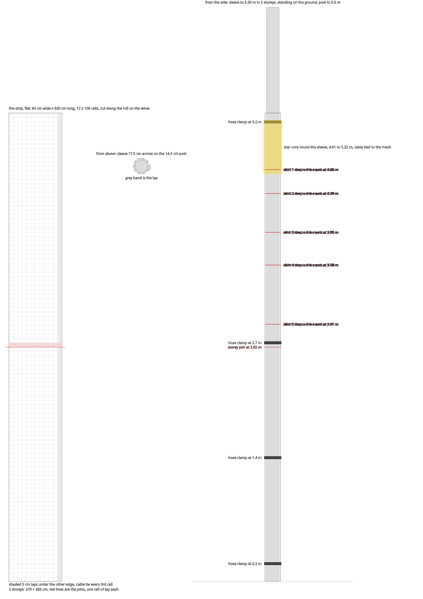

Install plan: rope over the lamp arm with a throw line, padded where it
crosses the arm. Assemble sleeve, skirts and star round the post on the
ground, hoist, then tighten the clamps at 0.2 and 1.4 m from the ground or a
step ladder. The rope is a hoist and a backstop, never a personal anchor.
Nothing pegged within a metre of the post base, because of the buried cable,
and the bottom ring is tied down to stakes at the shrub line or to the
shrubs. Coming down in January is the same list backwards, and the tie wire
is the slow part, so bring side cutters and a bag for the offcuts.

Weight, at 0.8 kg a square metre of fabric, which is 18 g for a 15 cm
square: fabric about 20 kg dry, 42 kg soaked and 27 kg after draining. Mesh
sleeve 4.8 kg, rings 2.6 kg, star and cords and straps 3 kg. That is about
50 kg wet on the sleeve's foot. Weigh one real square and recompute, because
that one number drives all of it.

### Wind

Wind is the biggest load on the structure, and nothing is sized for it. The
five skirts and the star present about 7 m² side on. Dynamic pressure is 0.6
times the square of the wind speed, so 10 m/s gives 60 Pa and 20 m/s gives
240 Pa. Granny fabric is full of holes, and wet acrylic mats and closes up,
so the drag coefficient is somewhere between 0.4 and 0.9. That is a sideways
load of 20 to 40 kg at 10 m/s and 70 to 160 kg at 20 m/s. Edithvale faces
the bay, so 20 m/s is an ordinary winter front and not a rare one.

An attachment fails before the post does. The wind works on the cable ties
at the straps, the friction of the four clamps on compressed foam, and the
star where it meets the sleeve. The sleeve can also turn on the post,
because clamp friction is the only thing that stops it.

This is accepted rather than solved. The heaviest part is the mesh sleeve at
4.8 kg, and it is clamped to the post rather than hanging off it. Everything
that could come away is fabric, fibreglass, bamboo or foam, so a failure
drops something light. If a piece comes loose, the tree comes down for the
season.

The star is the one part worth a second thought, because it is 4.9 m up over
a path and 490 mm bamboo stakes are stiff enough to hurt.

## Plan B, if the squares run short

Crochet toward all five skirts. If by November the count is short, leave skirt
5 off and bring the whole tree down 1.23 m, so skirt 4's hem lands where skirt
5's was. The tree still stands on the ground rather than floating with bare
sleeve beneath it.

|             | five skirts      | four skirts      |
| ----------- | ---------------- | ---------------- |
| squares     | 829              | 483              |
| base        | 275 cm at 0.54 m | 195 cm at 0.54 m |
| top strap   | 4.66 m           | 3.43 m           |
| star centre | 4.92 m           | 3.69 m           |
| mesh sleeve | 5.3 m            | 4.0 m            |

It costs 42 percent of the crochet, not the 37 percent skirt 5 represents,
because lowering the tree also raises the viewer's sight line and merges more
of skirt 4 out of view.

Every skirt keeps its cone, so the patterns for skirts 1, 2 and 3 serve both
plans unchanged. Skirt 4 is the one that differs. Lowered, more of it is out
of sight, so the merge to 7 a row comes four rows earlier. It runs 14 a row
for 10 rows and then 7 for 5, instead of 14 for 14 and then 7 for 3, and the
count drops from 217 to 175. That is where 483 comes from rather than 525.
Crocheting the five-skirt pattern and merging late by hand keeps both plans
open, and nothing crocheted is wasted by deciding in November. The drawings
are `section-b.svg` and `mesh-b.svg`, and the model is
`platonic/tree-b.stl`.

The cost is the star. It drops to 3.69 m, less striking from across the road
and within reach of a tall person.

## What is still open

- **How far the fabric stretches.** Acrylic granny fabric hanging wet under its
  own weight is untested, and it decides whether the patterns need a correction
  factor. The test: crochet a strip of three 36 cm squares joined on point,
  measure it relaxed and dry, then hang it by the top tip, soak it, hang 1 kg
  from the bottom and leave it overnight. Measure again wet and loaded, then
  dry and unloaded for what stays. Squares on point do not stretch like a
  sheet, they shear: each square becomes a rhombus, taller and narrower in
  equal measure, so five percent taller is five percent narrower.
- **How deep the fabric really hangs.** The droop between cords is a guess at
  45 percent of the way down to the hem plane, which puts skirt 5's fabric
  27 cm below the plain cone at its lowest. The stretch test will say whether
  that is close.
- **How many cords.** One per two hem squares now, so 4 / 5 / 6 / 7 / 8, which
  keeps every square within one square of a cord. Skirt 5 is 12.3 m² and about
  20 kg wet, so one of its sixteen columns of squares is about 1 kg at the
  strap, which is the stretch test's load. Halving the cords puts four
  columns on each one instead of two.
- **How the star hangs on the mesh sleeve.** Its hubs sit 305 mm out from the
  centre and the sleeve is only 87.5 mm in radius, so nothing reaches. It needs
  a spoke, a strap or a collar, and none is drawn.
- **Skirt 4's top row** stops 10 cm short of the post, because 14 squares a row
  merges to 7 and 7 cannot halve again. Tie the corners across the gap, or
  accept the gap; it is hidden under skirt 3.
- **Whether skirt 5 needs a merge line by hand.** From a 1 m eye height at the
  bottom hem, skirt 5 is out of sight above 2.54 m and the other four are in
  view all the way up. The merge the script found there did not change skirt
  5's count, so a hand-set height may be better.
- **The skirts are cut for the post, not for the sleeve.** `HOOP_D` is 145 mm
  everywhere, so every flat pattern's inner arc is the 14.5 cm post. The
  straps go round the 17.5 cm sleeve, which is 9.4 cm more circumference.
  Either set `HOOP_D` to 175 and regenerate, which changes the counts, or
  take up the 9.4 cm in the slack of the top row.
- **How the two upper clamps are fitted.** Nothing reaches 2.7 m or 5.2 m
  from the ground. A step ladder gets to the first and a socket on an
  extension pole might get to the second, and neither is tried.
- **Whether the straps should use tie wire rather than cable ties.** Cable
  ties are rejected for the mesh joins because they creep and perish in UV,
  and the same month of sun falls on the straps.
- **Whether the stakes need glue in the hubs.** A 5 mm stake in a 5.1 mm bore
  is a slip fit, and only the crochet holds it in.
- **Council permission, and the pole itself.** The post is a council light
  pole, so there is a question of consent, and a second one about clamping a
  5.3 m steel sleeve to it where a child can touch the sleeve at 54 cm.

## Sources

- Jack 60 cm x 8 m cage mesh, 50 x 25 mm, 2 mm galvanised, $84.98 at Bunnings.
  The 60 cm is exactly the strip width, so nothing is slit lengthwise:
  https://www.bunnings.com.au/jack-60cm-x-8m-50-x-25mm-heavy-duty-cage-mesh_p3040240
- Jack 30 cm x 5 mm bamboo flower stakes, 50 pack, $3.65 at Bunnings. The core
  stakes, at the right length already:
  https://www.bunnings.com.au/jack-30cm-x-5mm-bamboo-flower-stakes-50-pack_p0188977
- Hose clamp, Kinetic 159-181 mm:
  https://www.bunnings.com.au/kinetic-159-181mm-304-stainless-steel-hose-clamp_p0110748
- Fibreglass tent pole kit, two 4.9 m poles of nine 57.7 cm segments, about
  11 mm outside on an 8 mm bore, $32.87 at Amazon Australia. The same pole is
  sold under several brand names at slightly different prices; buy whichever is
  cheaper on the day:
  https://www.amazon.com.au/dp/B0F85P5QBZ
- OZtrail fibreglass pole kits, 7.9 to 12.5 mm but only 2.4 m a kit, at BCF:
  https://www.bcf.com.au/p/oztrail-fibreglass-tent-pole-kit-9.5mm/311328.html
- Metal Mate aluminium round tube at Bunnings, the fallback if a hoop turns out
  not to suit, 10 mm at $3.55 a metre:
  https://www.bunnings.com.au/products/building-hardware/steel-aluminium-sections/aluminium-extrusions-mouldings/aluminium-tubes

## Working notes

Written in September 2026 and checked against the scripts on 2026-10-21.
`platonic.md` has the piece as a whole, and this file is only the tree.

### One source of numbers

Every skirt and star number is in `platonic/skirts.py`. Running it writes
`platonic/tree_params.scad`, which the OpenSCAD model includes, and
`platonic/mesh.py` imports from it. Never edit the scad's numbers by hand.
The sleeve's own numbers, its height, the storeys and the clamp heights, are
in `platonic/mesh.py`. The weights and the costs are in this file alone.

    make tree                        # patterns, section, params, STL, mesh sketch
    make tree-b                      # section, params, STL, mesh sketch for plan B
    python3 platonic/skirts.py all     # skirt-1..5.svg + section.svg + params
    python3 platonic/skirts.py 5       # one skirt
    python3 platonic/skirts.py 5 300   # one skirt with a 30 cm hem square, separate file
    python3 platonic/skirts.py b       # plan B section and params
    python3 platonic/mesh.py           # mesh.svg
    python3 platonic/mesh.py b         # mesh-b.svg

Outputs, all in `platonic/drawings/`: `skirt-1.svg` to `skirt-5.svg`, `section.svg`,
`mesh.svg`, and `section-b.svg` and `mesh-b.svg` for plan B.

The model of the whole tree is
[platonic/tree.stl](tree.stl), which GitHub renders in the
browser, and [platonic/tree-b.stl](tree-b.stl) is plan B.
`tree-body.scad` holds the shape; `tree.scad` and `tree-b.scad` each
include it after their own numbers, so the shape is described once.
